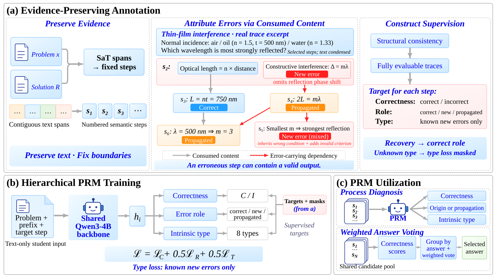

# Tracing Error Origins and Propagation

Code accompanying **Tracing Error Origins and Propagation: Dependency-Grounded
Process Supervision for Mathematics and Physics**.

**Anonymous submission to ICLR 2027.** Author information and public citation
metadata will be added after anonymous review.

[Overview](#overview) · [Method](#method) · [Results](#results) ·
[Quick start](#quick-start) · [Experiments](docs/EXPERIMENTS.md) ·
[Reproduction guide](docs/REPRODUCTION.md)

## Overview

Mathematical and physical reasoning is central to AI for Science. Process reward
models (PRMs) support this reasoning by evaluating intermediate steps, but an
incorrect step can either introduce a mistake or inherit one from an earlier
step. These cases call for different feedback.

Derivations reuse quantities, equations, and assumptions through identifiable
input-output dependencies. We use these dependencies to construct supervision
for **step correctness, error origin or propagation, and intrinsic error type**.
Attribution follows the content actually consumed: a valid output from a
partially incorrect step can still support correct reasoning, while a step can
both inherit an error and introduce a new one.

The study connects this annotation design to PRM training, evaluates detection
and role diagnosis in mathematics and physics, and examines process scores in
answer voting and training-data selection.

## Method



1. **Extract inputs and outputs.** Preserve the solution text, establish step
   boundaries, and identify the quantities and premises each step uses and produces.
2. **Attribute errors through consumed content.** Separate locally introduced
   mistakes from invalid consequences inherited through the step's inputs.
3. **Learn hierarchical supervision.** Train a Qwen3-4B PRM with correctness,
   role, and intrinsic-type heads. At inference, the model evaluates the problem,
   preceding reasoning, and current step.

| Step situation | Correctness target | Role target | Intrinsic-type supervision |
|---|---|---|---|
| Contextually correct | Correct | Correct | Inactive |
| Introduces a mistake | Incorrect | New error | Active when the type is known |
| Inherits an error without a new mistake | Incorrect | Propagated error | Inactive |
| Inherits an error and introduces another | Incorrect | New error; inherited causes retained in annotations | Type of the newly introduced mistake |
| Recovers valid reasoning | Correct | Correct | Inactive |

Correctness and role supervision cover all evaluable steps. Type supervision
applies to known new-error types, including mixed errors. The full objective is
`L = L_correctness + 0.5 L_role + 0.5 L_type`.

The [annotation prompts](configs/annotation/prompts/),
[target converter](src/annotation/prepare_prm800k_phase2_hierarchical.py), and
[training configurations](configs/table2/) implement these stages.

## Results

### Error detection in mathematics and physics

Existing-model comparison from Table 1; Error AP is reported in percent.

| Model | PRM800K | Annotated physics subset |
|---|---:|---:|
| Binary PRM | 72.85 | 70.66 |
| Three-class PRM | 75.77 | 75.83 |
| Hierarchical PRM | **86.33** | **84.23** |

These are comparisons of models with different training histories. The separate
shared-label study below fixes initialization and dependency-derived labels to
compare supervision objectives.

### Error-role diagnosis under shared labels

Table 2(b) compares learned role predictions with a sequential rule applied to
full-trace binary scores. The rule marks the first predicted error as new and
subsequent predicted errors as propagated.

| Predictor | Role macro-F1 (%) | New-error F1 (%) | Propagated-error F1 (%) |
|---|---:|---:|---:|
| Full-trace binary scores + sequential rule | 66.24 | 46.81 | 69.61 |
| Hierarchical role head | **70.80** | **58.90** | **71.81** |

The role macro-F1 improvement is **4.56 points** (paired 95% CI [3.37, 5.72]).
Detection AP is similar for full hierarchy and full-trace binary supervision
(86.58% vs. 86.53%). This comparison measures the diagnostic information added by
role supervision while holding attribution labels fixed.

The paper also reports reasoning-length and first-error-position analyses,
ProcessBench evaluation, answer voting, and SFT data selection. The
[experiment map](docs/EXPERIMENTS.md) connects these studies to their code and
configurations, including the recorded scorer used for SFT selection.

## Quick start

### Run the label-construction example

Requires Python 3.12; no additional packages, model, API key, or dataset are needed.
From the repository root:

```bash
python examples/label_conversion.py
```

The example runs the actual target converter on a synthetic ideal-gas derivation
with supplied labels. It covers new and propagated errors, a correct step after
an error, a mixed error, and recovery. It writes the input, trajectory targets,
and per-step training rows to `outputs/example_*` and checks label masks and
reasoning prefixes. This example demonstrates target construction; automatic
annotation and model evaluation use the separate entries below.

### Reproduce experiments

The example and CPU tests run with this repository alone. Recomputing the paper's
results requires external prediction bundles, which are not included or currently
available for download from this repository.

Install the CPU replay dependencies in a separate environment:

```bash
python -m venv .venv-cpu
# Activate .venv-cpu using your platform's activation command.
python -m pip install -r environments/cpu/requirements.txt
python -m unittest discover -s tests -v
```

Given the corresponding external prediction bundle, replay the shared-label study:

```bash
python scripts/reproduce.py --module table2 --table2-bundle /path/to/formal_bundle --verify
python scripts/reproduce.py --module roles --table2-bundle /path/to/formal_bundle --verify
```

For training, annotation, other evaluation modules, and required assets, see the
[reproduction guide](docs/REPRODUCTION.md).

## Repository structure

| Directory | Contents |
|---|---|
| [`src/annotation/`](src/annotation/) | Step processing, dependency attribution, and training-target construction |
| [`src/table2/`](src/table2/) | Shared-label training objectives and result reporting |
| [`src/existing_eval/`](src/existing_eval/) and [`src/benchmarks/`](src/benchmarks/) | Mathematics, physics, and ProcessBench evaluation |
| [`src/downstream/`](src/downstream/) | Answer voting, SFT selection, training, and task evaluation |
| [`configs/`](configs/) | Annotation prompts, training settings, evaluation protocols, and reference metrics |
| [`scripts/`](scripts/) | Reproduction and training-preparation entry points |
| [`examples/`](examples/) | Self-contained synthetic example |
| [`environments/`](environments/) | CPU dependencies and training/evaluation environment records |
| [`docs/`](docs/) | Experiment mapping, reproduction instructions, and resource availability |

## Resources and availability

This release contains source code, prompts, configurations, reference metrics, and
the synthetic example. Model weights, original datasets, and prediction caches
are not bundled. Public dataset sources and private-data restrictions are listed
in [Data access](docs/DATA_ACCESS.md). The provider-supplied problem collection
cannot be redistributed.

All seven CPU replay modules have been checked internally against the stored
experiment outputs. Fresh GPU training/inference and Linux execution have not
been validated for this release. See [Release status](docs/RELEASE_STATUS.md) for
the current scope.

Author-code licensing is pending. Third-party notices and component-specific
terms are recorded in [THIRD_PARTY_NOTICES.md](THIRD_PARTY_NOTICES.md).
